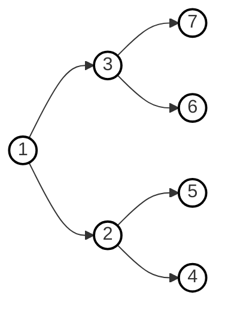

# Riskless Zero-Coupon Bonds (ZCB) & Filtration
**Theorem:** Let $P$ & $Q$ be riskless ZCB with maturity time '$T$', then they are equal at all the time.
**Proof:**
- Let $P$ & $Q$ be ZCB having value '1' at time $T$.
- Then, by monotonicity theorem, $P \leq Q \quad \forall t < T$.
- Similarly, $Q \leq P \quad \forall t < T$.
- $\Rightarrow P = Q \quad \forall t < T$.
## Filtration
- **Graph with equal probability $P$**
![[Pasted image 20261110124538.png]]

- **Graph with different probability $Q$**

![[Pasted image 20261110124433.png]]
- **Graph with nodes numbered**

| **Nodes**      | **1**   | **2**      | **3**      | **4**         | **5**         | **6**         | **7**         |
| -------------- | ------- | ---------- | ---------- | ------------- | ------------- | ------------- | ------------- |
| **Filtration** | $\{1\}$ | $\{1, 2\}$ | $\{1, 3\}$ | $\{1, 2, 4\}$ | $\{1, 2, 5\}$ | $\{1, 3, 6\}$ | $\{1, 3, 7\}$ |
- $P = \{1/2, 1/2, 1/2, \dots \}$ - equal probability
- $Q = \{1/3, 2/3, 2/3, 1/3, 2/5, 3/5\}$

Examples of expected values under different measures:
* $\mathbb{E}^Q[S_3 | F_0] = \frac{1}{3} \times 120 + \frac{2}{5} \times 60 = 80$
* $\mathbb{E}^P[S_1 | F_0] = \frac{1}{2} \times 120 + \frac{1}{2} \times 60 = 90$
* $\mathbb{E}^Q[S_2 | F_1] = \frac{2}{5} \times 180 + \frac{3}{5} \times 80 = 120$

___
# Martingale
A stochastic process is said to be a Martingale if it satisfies the following properties w.r.t a filtration:
1. $M_t$ is adapted to $F_t$
2. $\mathbb{E}[|M_t|] < \infty$
3. $\mathbb{E}[M_t | F_s] = M_s$ (for $s < t$)

*Note: $P$ is not a martingale but $Q$ is.*

___
# Random Walk
For a Random Variable $X_i$:
$$
X_i = 
\begin{cases} 
1 & \text{for } w_i = H \\ 
-1 & \text{for } w_i = T 
\end{cases}
$$

Random walk is defined as $M_0 = 0$ and:
$$
M_k = \sum_{i=1}^{k} X_i
$$

Properties:
* $\mathbb{E}[M_k] = 0$
* $Var[M_k] = k$

> [!note] Can a Random walk be a Martingale?
> 
>   
>$$
>\mathbb{E}[M_{n+1} \vert{} F_n] = M_n
>$$
> **Proof:**
> - $\mathbb{E}[M_n + X_{n+1} \vert{} F_n] = \mathbb{E}[M_n \vert{} F_n] + \underbrace{\mathbb{E}[X_{n+1} \vert{} F_n]}_{0}$
> - $= \mathbb{E}[M_n \vert{} F_n]$
> - $= M_n$

___
# Brownian Motion
A random process $W_t$ is said to be a Brownian motion if:
1. $W_0 = 0$
2. $W_t$ has independent increments.
3. $W_t - W_s \sim \mathcal{N}(0, t-s)$
4. $W_t$ is continuous.

> [!note] Is BM a Martingale?
> Yes.
> $$ \mathbb{E}[W_t | F_s] = W_s $$
> **Proof:**
> * $\mathbb{E}[W_t | F_s] = \mathbb{E}[W_t - W_s + W_s | F_s]$
> * $= \mathbb{E}[W_t - W_s | F_s] + \mathbb{E}[W_s | F_s]$
> * $= 0 + W_s$
> * $= W_s$

___
# Markov Process
Let $f$ and $g$ be measurable (Borel) functions. 
$$
\mathbb{E}[f(X_t) | F_s] = g(X_s), \quad s < t
$$
Then $X(t)$ is called a Markov Process.

## Ito's Multiplication Rule
1. $dW \cdot dW = dt$
2. $dW \cdot dt = 0$
3. $dt \cdot dt = 0$

___
# Theorem: Ito-Doeblin Formula for Brownian Motion
Let $f(t,x)$ be a function for which partial derivatives $f_t$, $f_x$, and $f_{xx}$ are defined and continuous. Let $W_t$ be a Brownian Motion, then for $T \ge 0$:
$$
f(T, W_T) = f(0, W_0) + \int_{0}^{T} f_t(t, W_t) dt + \int_{0}^{T} f_x(t, W_t) dW_t + \frac{1}{2} \int_{0}^{T} f_{xx}(t, W_t) dt
$$
The differential form is:
$$
df = f_t dt + f_x dW + \frac{1}{2} f_{xx} dt
$$

___
# Theorem: Ito-Doeblin Formula for Ito's Process
Let $f(t,x)$ be a function for which partial derivatives $f_t$, $f_x$, and $f_{xx}$ are defined and continuous. Let $X(t)$ be an Ito's process. Then for $t \ge 0$:
$$
df = f_t dt + f_x dX + \frac{1}{2} f_{xx} dX dX
$$

### Example
Let $f(t, W_t) = \frac{1}{2} W_t^2$.
Here, $f_t = 0$, $f_x = W_t$, and $f_{xx} = 1$.
Take $X = W_t$, apply the Ito-Doeblin formula:
$$
d\left(\frac{1}{2} W^2\right) = 0 + W dW + \frac{1}{2} (1) dW dW
$$
$$
d\left(\frac{1}{2} W^2\right) = W dW + \frac{1}{2} dt
$$
Integrating both sides:
$$
\int_{0}^{t} d\left(\frac{1}{2} W^2\right) = \int_{0}^{t} W dW + \frac{1}{2} \int_{0}^{t} dt
$$
$$
\frac{1}{2} W_t^2 = \int_{0}^{t} W dW + \frac{1}{2} t
$$
Rearranging gives the integral of Brownian motion:
$$
\int_{0}^{t} W dW = \frac{1}{2} W_t^2 - \frac{1}{2} t
$$

___
# Ito's Process / Stochastic Differential Equation (SDE)
Let $u, v$ be adaptive processes. An Ito's process $X(t)$ can be defined as:
$$
X(t) = X(0) + \int_{0}^{t} u dt + \int_{0}^{t} v dW
$$
Equivalently in differential form:
$$
dX = u dt + v dW
$$
which is the form of a stochastic differential equation.

**General form:**
$$
dX(t) = a(t, X) dt + b(t, X) dW
$$

**Special case:**
$$
dX(t) = \mu(t, X) dt + \sigma(t, X) dW
$$
Where $\mu$ is the Drift and $\sigma$ is the Diffusion.

___
# Theorem: Generalized Ito's Lemma
Suppose that an Ito process is given by $dX(t) = a(t, X) dt + b(t, X) dW$. Then for any $f \in C^2$:
$$
df = \left(f_t + a f_x + \frac{1}{2} b^2 f_{xx}\right) dt + b f_x dW
$$

As a **special case**, if the SDE is:
$$
dX(t) = \mu(t) dt + \sigma(t) dW(t)
$$
Then:
$$
df = \left(f_t + \mu f_x + \frac{1}{2} \sigma^2 f_{xx}\right) dt + \sigma f_x dW
$$