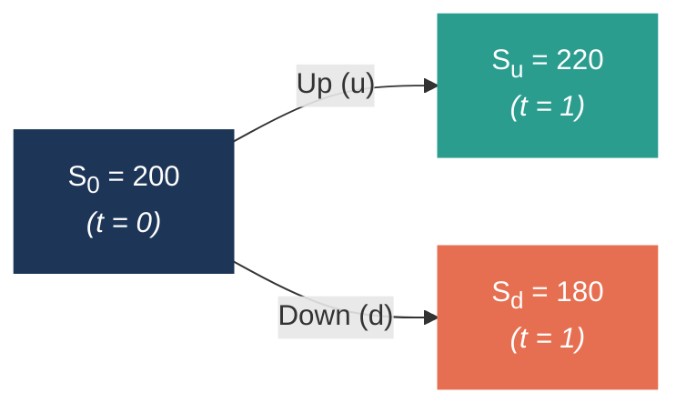

### Expected Return & Variance of a Two-Asset Portfolio

#### Expected Return

$$
E(R_V) = w_1 E(r_1) + w_2 E(r_2) \quad \text{or} \quad \mu_V = w_1 \mu_1 + w_2 \mu_2
$$

*Note:* Weights $w_i$ can be negative if short selling is permitted (e.g., $w_1 = 125\%, w_2 = -25\%$).

#### Example: Two-Asset Expected Return

| Scenario | Probability | TCS ($r_1$) | Infosys ($r_2$) |
| :--- | :---: | :---: | :---: |
| $\omega_1$ | $0.5$ | $12\%$ | $10\%$ |
| $\omega_2$ | $0.5$ | $10\%$ | $8\%$ |

* $E(r_1) = 0.5(0.12) + 0.5(0.10) = 0.11 \quad (11\%)$
* $E(r_2) = 0.5(0.10) + 0.5(0.08) = 0.09 \quad (9\%)$

With weights $w_1 = 40\%$ (TCS) and $w_2 = 60\%$ (Infosys):

$$
E(R_V) = 0.40(0.11) + 0.60(0.09) = 0.044 + 0.054 = 0.098 \quad (9.8\%)
$$

---

#### Portfolio Variance

$$
V(R_V) = V(w_1 r_1 + w_2 r_2)
$$

$$
\sigma_V^2 = w_1^2 V(r_1) + w_2^2 V(r_2) + 2 w_1 w_2 \text{Cov}(r_1, r_2)
$$

$$
\sigma_V^2 = w_1^2 \sigma_1^2 + w_2^2 \sigma_2^2 + 2 w_1 w_2 \rho_{12} \sigma_1 \sigma_2
$$

Where:
* Correlation Coefficient: $\rho_{12} = \frac{\text{Cov}(r_1, r_2)}{\sigma_1 \sigma_2}$
* Covariance formula: $\text{Cov}(r_1, r_2) = E(r_1 r_2) - E(r_1)E(r_2)$

---

### Theorem 2: Upper Bound on Portfolio Variance
> **Theorem:** The variance $\sigma_V^2$ of a two-asset portfolio cannot exceed the maximum variance of its components if short selling is not allowed ($w_1, w_2 \ge 0$).
> 
$$
\sigma_V^2 \le \max \{\sigma_1^2, \sigma_2^2\}
$$

#### Proof:
Assume without loss of generality that $\sigma_1^2 \le \sigma_2^2 \implies \sigma_1 \le \sigma_2$.

Since $-1 \le \rho_{12} \le 1$:

$$
\sigma_V^2 = w_1^2 \sigma_1^2 + w_2^2 \sigma_2^2 + 2 w_1 w_2 \rho_{12} \sigma_1 \sigma_2
$$

$$
\sigma_V^2 \le w_1^2 \sigma_1^2 + w_2^2 \sigma_2^2 + 2 w_1 w_2 \sigma_1 \sigma_2
$$

$$
\sigma_V^2 \le (w_1 \sigma_1 + w_2 \sigma_2)^2
$$

Since $\sigma_1 \le \sigma_2$ and $w_1, w_2 \ge 0$:

$$
w_1 \sigma_1 + w_2 \sigma_2 \le w_1 \sigma_2 + w_2 \sigma_2 = (w_1 + w_2) \sigma_2 = 1 \cdot \sigma_2 = \sigma_2
$$

Therefore:

$$
\sigma_V^2 \le \sigma_2^2
$$

Similarly, if $\sigma_2^2 \le \sigma_1^2$, then $\sigma_V^2 \le \sigma_1^2$.  
Hence, $\sigma_V^2 \le \max \{\sigma_1^2, \sigma_2^2\}$. $\quad \blacksquare$

---

## Portfolio with $n$ Securities

For $n$ assets with returns $r_1, r_2, \dots, r_n$, weights $w_i = \frac{x_i S_i}{V}$, where $\sum_{i=1}^n w_i = 1$:

* **Portfolio Return:**
  
$$
R_V = \sum_{i=1}^n w_i r_i
$$

* **Expected Return:**
  
$$
E(R_V) = \sum_{i=1}^n w_i E(r_i) = \sum_{i=1}^n w_i \mu_i
$$

* **Variance in Matrix Form:**
  
$$
V(R_V) = \mathbf{w} \mathbf{C} \mathbf{w}^T
$$

  where $\mathbf{C}$ is the covariance matrix with entries $C_{ij} = \text{Cov}(r_i, r_j)$:
  
$$
\mathbf{C} = \begin{pmatrix} C_{11} & C_{12} & \dots & C_{1n} \\ C_{21} & C_{22} & \dots & C_{2n} \\ \vdots & \vdots & \ddots & \vdots \\ C_{n1} & C_{n2} & \dots & C_{nn} \end{pmatrix}
$$

---

### Practice Problem: 3-Security Portfolio

Given 3 securities with parameters:
* **Expected Returns:** $\mu_1 = 8\%$, $\mu_2 = 10\%$, $\mu_3 = 6\%$
* **Standard Deviations:** $\sigma_1 = 1.5\%$, $\sigma_2 = 0.5\%$, $\sigma_3 = 1.2\%$
* **Correlations:** $\rho_{12} = 0.3$, $\rho_{13} = 0$, $\rho_{23} = -0.2$
* **Weights:** $w_1 = 40\%$, $w_2 = -20\%$, $w_3 = 80\%$

#### Solution:

1. **Expected Return ($\mu_V$):**
   
$$
\mu_V = w_1 \mu_1 + w_2 \mu_2 + w_3 \mu_3
$$

   
$$
\mu_V = (0.40)(8\%) + (-0.20)(10\%) + (0.80)(6\%) = 3.2\% - 2.0\% + 4.8\% = 6.0\%
$$

2. **Covariances:**
   * $C_{11} = \sigma_1^2 = 1.5^2 = 2.25$
   * $C_{22} = \sigma_2^2 = 0.5^2 = 0.25$
   * $C_{33} = \sigma_3^2 = 1.2^2 = 1.44$
   * $C_{12} = \rho_{12} \sigma_1 \sigma_2 = 0.3 \times 1.5 \times 0.5 = 0.225$
   * $C_{13} = \rho_{13} \sigma_1 \sigma_3 = 0 \times 1.5 \times 1.2 = 0$
   * $C_{23} = \rho_{23} \sigma_2 \sigma_3 = -0.2 \times 0.5 \times 1.2 = -0.12$

3. **Variance ($\sigma_V^2$):**
   
$$
\sigma_V^2 = \sum_{i=1}^3 w_i^2 \sigma_i^2 + 2 w_1 w_2 C_{12} + 2 w_1 w_3 C_{13} + 2 w_2 w_3 C_{23}
$$

   
$$
\sigma_V^2 = (0.4)^2(2.25) + (-0.2)^2(0.25) + (0.8)^2(1.44) + 2(0.4)(-0.2)(0.225) + 0 + 2(-0.2)(0.8)(-0.12)
$$

   
$$
\sigma_V^2 = 0.36 + 0.01 + 0.9216 - 0.036 + 0 + 0.0384 = 1.294 \implies \sigma_V \approx 1.138\%
$$

---

## Discrete-Time Model & Option Hedging

### One-Period Binomial Model
* Initial stock price $S_0 = 200$
* Stock price at $t = 1$:
  * Up state: $S_u = 220$
  * Down state: $S_d = 180$
* Call Option Strike Price $K = 210$

---

### Call Option Payoffs at Expiration ($t = 1$)

$$
\text{Payoff} = \max\{S_T - K, 0\}
$$

* **Up State ($S_1 = 220$):**
  
$$
C_u = \max\{220 - 210, 0\} = 10
$$

* **Down State ($S_1 = 180$):**
  
$$
C_d = \max\{180 - 210, 0\} = 0
$$

---

### Constructing a Riskless Portfolio
Consider a portfolio $\Pi$ consisting of selling $1$ call option and buying $\Delta$ shares of stock:

$$
\Pi = \Delta \cdot S - C
$$

At $t = 1$, the portfolio values in each state are:
* **Up State:** $\Pi_u = \Delta \times 220 - 10$
* **Down State:** $\Pi_d = \Delta \times 180 - 0$

To make the portfolio **riskless**, the payoff must be equal in both states ($\Pi_u = \Pi_d$):

$$
220 \Delta - 10 = 180 \Delta
$$

$$
40 \Delta = 10
$$

$$
\Delta = \frac{10}{40} = 0.25
$$

> **Conclusion:** Holding $0.25$ shares of stock against $1$ short call option creates a risk-free portfolio with a guaranteed payout of $\Pi_1 = 45$.