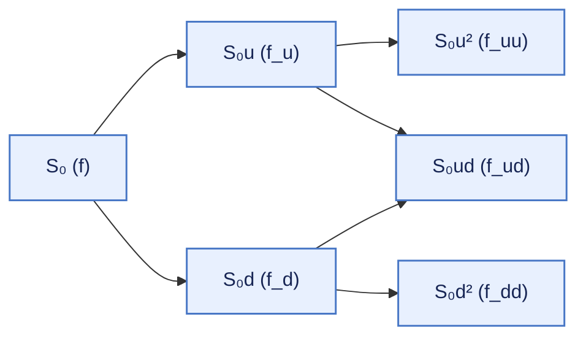

# Financial Engineering: Binomial Option Pricing Model

## 1. One-Period Binomial Model

### Mathematical Derivation for Option Price

Consider a stock and a European option over a single period $[0, T]$:

* $S_0$: Current price of the stock at $t = 0$
* $f$: Current price of the option at $t = 0$
* $u$: Up-movement factor ($S_u = S_0 u$)
* $d$: Down-movement factor ($S_d = S_0 d$)
* $f_u$: Option payoff when stock price goes up to $S_0 u$
* $f_d$: Option payoff when stock price goes down to $S_0 d$

To determine the fair price of the option $f$, construct a riskless portfolio $\Pi$ consisting of $\Delta$ shares of stock (long) and $1$ option (short):

$$
\Pi = \Delta S - f
$$

#### Delta ($\Delta$) Hedging

In order to make the portfolio **risk-free** at maturity $T$, the portfolio value must be identical regardless of whether the stock price moves up or down:

$$
\Delta S_0 u - f_u = \Delta S_0 d - f_d
$$

$$
\Delta S_0 (u - d) = f_u - f_d
$$

$$
\Delta = \frac{f_u - f_d}{S_0(u - d)}
$$

---

### Derivation of Risk-Neutral Pricing Formula

Since the portfolio is risk-free, it must earn the risk-free interest rate $r$. Discounting the value of the portfolio at time $T$ back to time $t = 0$:

$$
\Delta S_0 - f = e^{-rT} (\Delta S_0 u - f_u)
$$

$$
f = \Delta S_0 - e^{-rT} (\Delta S_0 u - f_u)
$$

Substituting $\Delta = \frac{f_u - f_d}{S_0(u - d)}$ into the equation:

$$
f = \left( \frac{f_u - f_d}{u - d} \right) - e^{-rT} \left[ \left( \frac{f_u - f_d}{u - d} \right) u - f_u \right]
$$

$$
f = \frac{f_u (1 - e^{-rT} u) - f_d (1 - e^{-rT} u) + (u - d) e^{-rT} f_u}{u - d}
$$

$$
f = e^{-rT} \left[ \left( \frac{e^{rT} - d}{u - d} \right) f_u + \left( \frac{u - e^{rT}}{u - d} \right) f_d \right]
$$

Let the **risk-neutral probability** $p$ be defined as:

$$
p = \frac{e^{rT} - d}{u - d} \quad \implies \quad 1 - p = \frac{u - e^{rT}}{u - d}
$$

Thus, the option pricing equation simplifies to:

$$
f = e^{-rT} \left[ p f_u + (1 - p) f_d \right]
$$

> **Key Takeaway:** The option price is the discounted expected value of its future payoff under the risk-neutral probability measure $p$.

---

### Expected Stock Price under Risk-Neutral Probability

The expected stock price at time $T$ under probability $p$ is given by:

$$
E[S_T] = p S_0 u + (1 - p) S_0 d
$$

$$
E[S_T] = \left( \frac{e^{rT} - d}{u - d} \right) S_0 u + \left( \frac{u - e^{rT}}{u - d} \right) S_0 d
$$

$$
E[S_T] = \frac{S_0 \left( e^{rT} u - ud + ud - e^{rT} d \right)}{u - d} = \frac{S_0 e^{rT} (u - d)}{u - d}
$$

$$
E[S_T] = S_0 e^{rT}
$$

---

## 2. Multi-Period Binomial Model (Two-Period Model)

For a two-period model with total maturity $T$, each time step has duration $\Delta t = \frac{T}{2}$.

### Binomial Tree Structure

### Risk-Neutral Probability per Step

$$
p = \frac{e^{r \Delta t} - d}{u - d}
$$

### Backward Induction Equations

1. **At Intermediate Nodes ($t = \Delta t$):**
   

   
$$
f_u = e^{-r \Delta t} \left[ p f_{uu} + (1 - p) f_{ud} \right]
$$

   
$$
f_d = e^{-r \Delta t} \left[ p f_{ud} + (1 - p) f_{dd} \right]
$$

2. **At Initial Node ($t = 0$):**
   

   
$$
f = e^{-r \Delta t} \left[ p f_u + (1 - p) f_d \right]
$$

### Generalized Two-Period Formula

Combining the step-by-step backward induction equations:

$$
f = e^{-2r \Delta t} \left[ p^2 f_{uu} + 2p(1 - p) f_{ud} + (1 - p)^2 f_{dd} \right]
$$

---

## 3. Worked Example: European Call Option Valuation

### Given Parameters

* Initial Stock Price $S_0 = 50$
* Strike Price $K = 52$
* Time to Maturity $T = 2 \text{ years}$ (2-period model $\implies \Delta t = 1 \text{ year}$)
* Up movement factor $u = 1.2$ ($+20\%$)
* Down movement factor $d = 0.8$ ($-20\%$)
* Risk-free rate $r = 5\% = 0.05$

---

### Step 1: Calculate Risk-Neutral Probability ($p$)

$$
e^{r \Delta t} = e^{0.05 \times 1} \approx 1.05127
$$

$$
p = \frac{e^{r \Delta t} - d}{u - d} = \frac{1.05127 - 0.8}{1.2 - 0.8} = \frac{0.25127}{0.4} \approx 0.6282
$$

$$
1 - p = 1 - 0.6282 = 0.3718
$$

---

### Step 2: Build the Stock Price Tree ($t = 0, 1, 2$)

* **$t = 0$:**
  * $S_0 = 50$

* **$t = 1$:**
  * $S_u = 50 \times 1.2 = 60$
  * $S_d = 50 \times 0.8 = 40$

* **$t = 2$:**
  * $S_{uu} = 60 \times 1.2 = 72$
  * $S_{ud} = 60 \times 0.8 = 48$
  * $S_{dd} = 40 \times 0.8 = 32$

---

### Step 3: Compute Call Option Payoffs at Expiration ($t = 2$)

Payoff formula for call option: $f = \max(S_T - K, 0)$

* $f_{uu} = \max(72 - 52, 0) = 20$
* $f_{ud} = \max(48 - 52, 0) = 0$
* $f_{dd} = \max(32 - 52, 0) = 0$

---

### Step 4: Backward Induction to Option Price ($f$)

1. **At $t = 1$:**
   

   
$$
f_u = e^{-0.05} \left[ 0.6282 \times 20 + 0.3718 \times 0 \right] = 0.95123 \times 12.564 \approx 11.95
$$

   
$$
f_d = e^{-0.05} \left[ 0.6282 \times 0 + 0.3718 \times 0 \right] = 0
$$

2. **At $t = 0$:**
   

   
$$
f = e^{-0.05} \left[ 0.6282 \times 11.95 + 0.3718 \times 0 \right] = 0.95123 \times 7.507 \approx 7.14
$$

### Final Result

The initial value of the European call option is **$f \approx 7.14$**.
